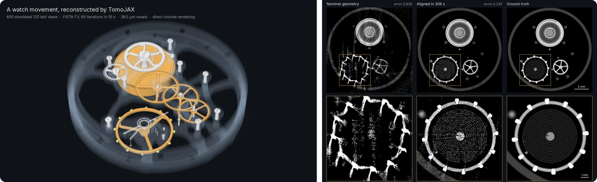
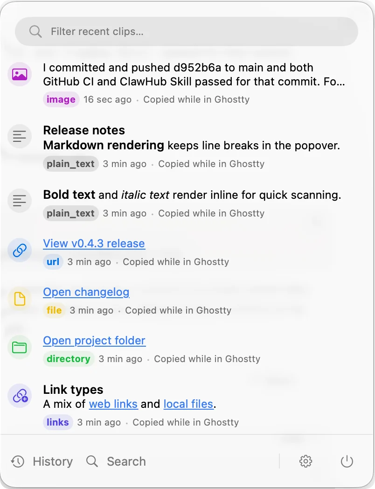
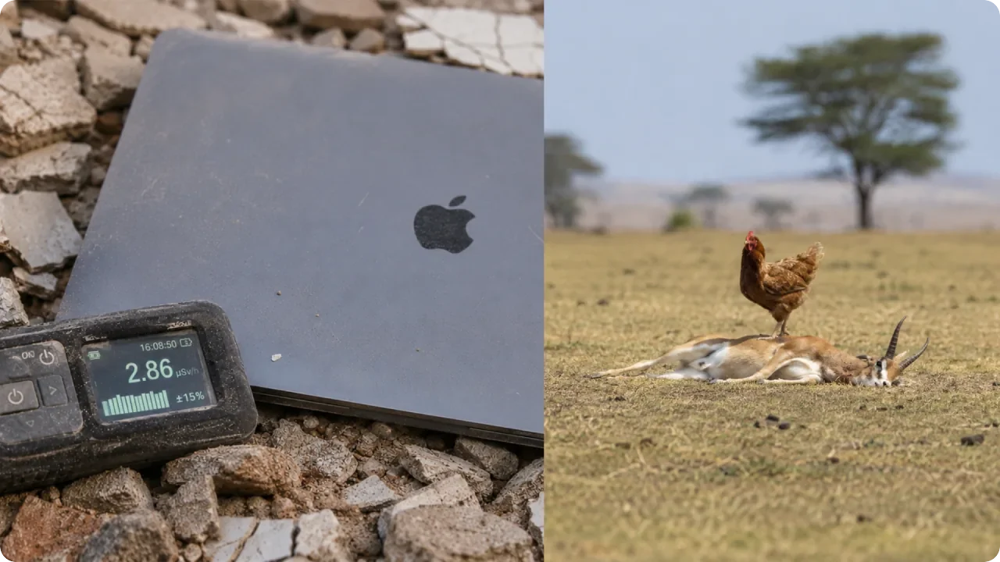
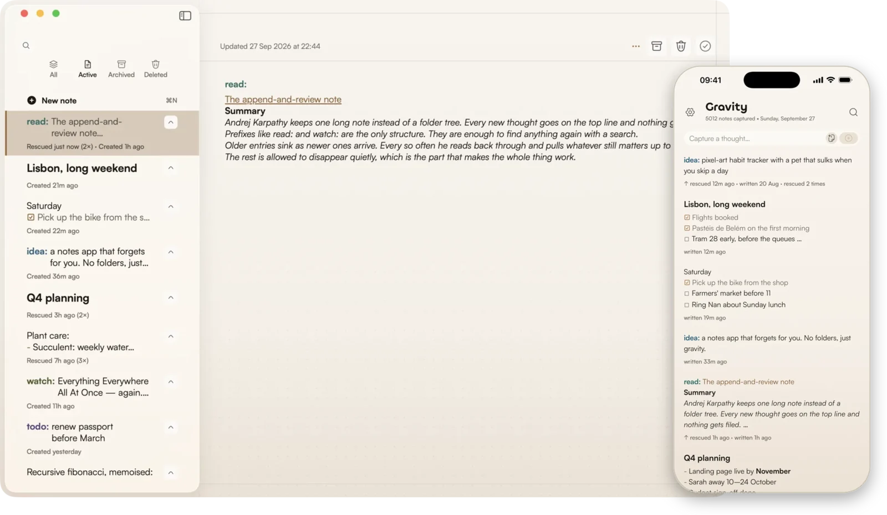
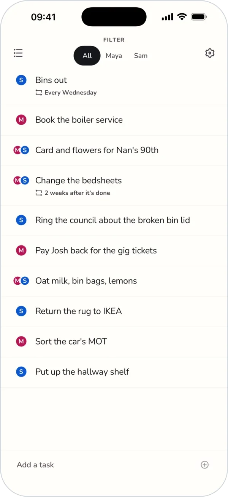
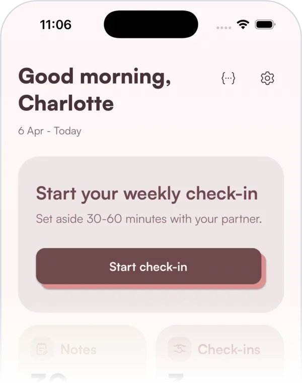
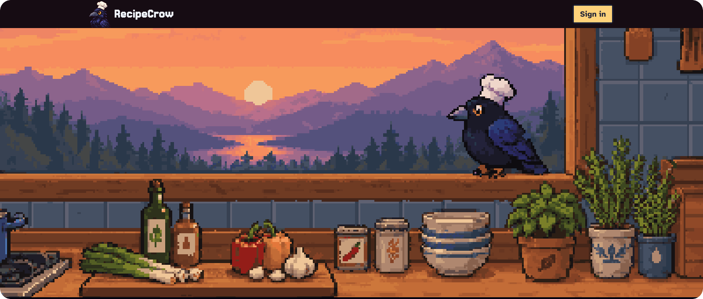
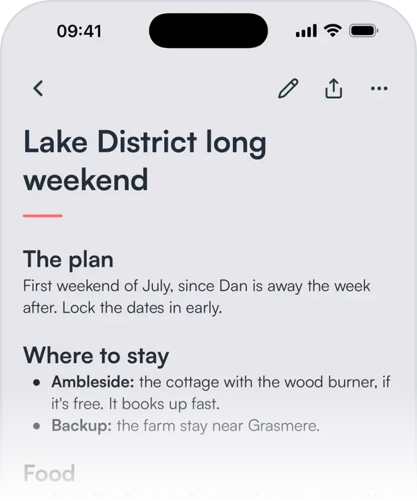

# Hi, I'm Tristan

I'm a software engineer in Munich. I build native apps, open-source tools for coding agents, and scientific software.

Before that I did a PhD in materials science and spent two years at [Diamond Light Source](https://www.diamond.ac.uk), the UK's national synchrotron, building instrumentation and deep-learning tools for X-ray imaging.

[tristanmanchester.com](https://www.tristanmanchester.com) · [LinkedIn](https://www.linkedin.com/in/tristanmanchester/) · [tristan@tristanmanchester.com](mailto:tristan@tristanmanchester.com)

## Open source

### [TomoJAX](https://github.com/tristanmanchester/tomojax)

Differentiable tomography in JAX for parallel-beam, laminography and lab cone-beam CT. It does FBP/FDK and iterative reconstruction, solves the volume and every view's pose together, and has a CLI that takes NeXus, APS, Nikon or TIFF scans through to slices. Above: a simulated watch movement, and the same scan with a wobbling sample before and after alignment. Docs at [tomojax.dev](https://tomojax.dev). Probably the most technically interesting thing I've built.

**Built with:** Python, JAX, Pallas, CUDA, HDF5

### [sifs](https://github.com/tristanmanchester/sifs)

Fast local code search for AI agents. Point it at a repo and ask "where is authentication handled?" and it returns ranked files, line ranges and code chunks, using BM25, semantic or hybrid ranking. Warm queries take 2.7 ms. Runs as a CLI, a Rust crate or an MCP server, and installs from [crates.io](https://crates.io/crates/sifs) or Homebrew.

**Built with:** Rust, Model2Vec, Tree-sitter

 

### [clipmem](https://github.com/tristanmanchester/clipmem)

A private clipboard memory for macOS. It saves everything you copy to a local SQLite archive and lets you search, recall and restore it from the terminal, the menu bar, or an agent like OpenClaw. Copied screenshots can be made searchable with on-device OCR. On [crates.io](https://crates.io/crates/clipmem) and Homebrew.

**Built with:** Rust, SQLite, objc2, Apple Vision

 

### [apocalypse-bench](https://github.com/tristanmanchester/apocalypse-bench)

You've got a laptop, a pile of scrap, and zero internet. Can an LLM help you survive without getting anyone hurt? 500 survival questions, judge-scored rubrics, an offline Wikipedia retrieval track, and a dashboard for exploring runs. [Full writeup here.](https://www.tristanmanchester.com/articles/apocalypse-bench)

**Built with:** TypeScript, Next.js, Rust

 

### [react-native-dotgrid](https://github.com/tristanmanchester/react-native-dotgrid)

An animated dot-matrix display for React Native, inspired by the ElevenLabs UI. Skia rendering, 60fps UI-thread animations with Reanimated, a VU meter mode for live audio, and a bunch of built-in presets. On [npm](https://www.npmjs.com/package/react-native-dotgrid).

**Built with:** React Native, Skia, Reanimated

 

### Smaller things

- [**rheo**](https://github.com/tristanmanchester/rheo): instant macOS Space switching. Swipe or use a shortcut and the Space changes without the slide animation. Rust core, native AppKit, and a CLI.
- [**agent-skills**](https://github.com/tristanmanchester/agent-skills): 36 skills for Claude Code, Codex and other agents, from App Store readiness audits to Skia animation.

## Apps

###  [Gravity](https://www.gravitynotes.app)

My most successful (and simplest) app, a notes app built around [Andrej Karpathy's note-taking technique](https://karpathy.bearblog.dev/the-append-and-review-note/). Everything goes into one stream, older notes sink, and a swipe rescues whatever still matters. People seem to particularly like that there's no subscription, and no AI. Runs on iPhone, iPad, Mac and Android, with a CLI for agents.

[App Store](https://apps.apple.com/app/id6756236079) · [Mac App Store](https://apps.apple.com/app/id6757930875) · [Google Play](https://play.google.com/store/apps/details?id=com.gravitynotes.app) 
**Built with:** SwiftUI, React Native Expo, TypeScript, SQLite, Rust

###  [Duolisto](https://duolisto.app)

A tiny shared to-do list for two. Couples, flatmates and families get one list with assignees, repeating chores and home-screen widgets, and nothing else to manage.

[App Store](https://apps.apple.com/app/id6794919219) · [Google Play](https://play.google.com/store/apps/details?id=app.duolisto) 
**Built with:** React Native Expo, Convex

 

###  [The Check-in](https://thecheckin.day)

A weekly check-in app for couples. Jot things down during the week, talk them through together in one guided check-in, and leave with a shared recap and a small pact for the week ahead.

[App Store](https://apps.apple.com/app/the-check-in/id6758762574) 
**Built with:** React Native Expo, Convex, Skia

 

###  [RecipeCrow](https://recipecrow.com)

Paste a recipe, drop a link, photograph a cookbook page or just read it out loud, and RecipeCrow adapts it to your diet, what's in your cupboard and your calorie target. Every dish gets a pixel-art portrait, and the kitchen outside the window follows your local time and weather.

**Built with:** Next.js, Convex, Clerk

###  [BrainFlow](https://brainflow.tech)

My least successful (and most complex) app, an AI voice-notes app which is the antithesis of Gravity. Talk through what's on your mind and get back a structured note with headings, a transcript and your to-dos pulled out. People seem to particularly like not using it.

[App Store](https://apps.apple.com/app/brainflow-ai-voice-notes/id6752835425) · [Google Play](https://play.google.com/store/apps/details?id=com.anonymous.BrainFlow) 
**Built with:** React Native Expo, Convex, Clerk, Vercel AI Gateway, RevenueCat

 

## Research background

At Diamond I built segmentation pipelines for synchrotron X-ray tomography. The reconstruction work later became TomoJAX.

| [ParticleSegmentation](https://github.com/tristanmanchester/ParticleSegmentation) | [ScrambledSeg](https://github.com/tristanmanchester/ScrambledSeg) |
|:-------------------:|:----------------------:|
|  |  |
| k-means and watershed segmentation | SegFormer deep-learning segmentation |

---
*Based in Munich, Germany 🇩🇪*
